# Engage+ demo script

**Length:** about 6 minutes (≈650 spoken words plus pauses for clicks) · **Presenter:** one narrator · **Format:** screen recording with voice-over, or a live demo
**App:** https://engage-plus.github.io/EngagePlus_SeniorProject/ (or locally: `cd apps/demo && npm ci && npm run dev`)
**Setup:** follow [demo-runbook.md](demo-runbook.md) first, and always **Reset demo data** before a take.

This script was written from a real run of the app. Every click below was tested end to end, and the screenshots in [`shots/`](shots/) show what you should see.

> **About the numbers.** The demo data reseeds each day, so dates and some counts shift. What stays the same: Caribbean Night Market is always #1 trending and the first swipe card; Example 1 always fills every field; the student always has 3 classes and 2–3 events hidden by the conflict filter. If you see a different event name where the script says "for example," just read what's on screen.

**How to read this:** each step has an **Action** (what you click), a **Say** line (read it word for word or put it in your own words), and sometimes a **You'll see** line (what should appear) or a **Tip**.

---

## Before you hit record (2 minutes)

1. Open the app in a clean Chrome profile.
2. Go to **Sign in**, click **Reset demo data**, then sign out with the arrow icon (top right) if you're signed in.
3. Open DevTools (F12), then the device toolbar (Ctrl+Shift+M). Choose **iPhone 12 Pro** (or 375 × 812). Undock DevTools or shrink it so only the phone frame is in the shot.
4. Go to the **Discover** page. Scroll to the top.
5. Have the title slide ready (Engage+ logo · "Find your people. Show up." · team names).

---

## Segment 1 · Hook — 0:00 to 0:30

**Action:** Show the title slide.

**Say:**
> "At Howard, there are dozens of events every week: workshops, cultural nights, recruiter mixers, open mics. But most students never hear about them, or they find out the day after on someone's Instagram story."

**Action:** Cut to the app on **Discover**, signed out.

**Say:**
> "Anthology Engage is the official record of every org and event, but it's a directory. It isn't built for discovery. So we built Engage+. It sits on top of Engage as a mobile-first website that helps you find events, and helps orgs fill them."

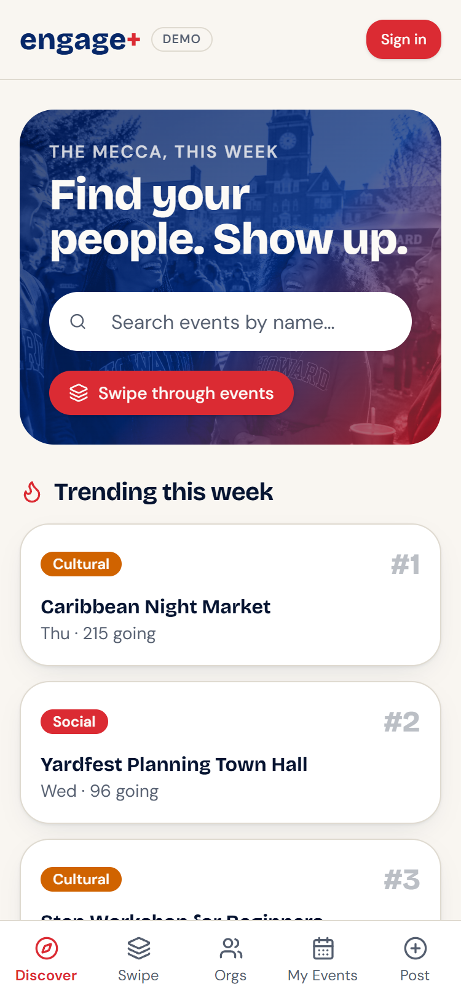

---

## Segment 2 · Discover — 0:30 to 1:15 · F4, F13

**Action:** Scroll slowly down to **Trending this week**.

**Say:**
> "The home page opens with what's trending: the events with the most RSVPs this week."

**You'll see:** #1 **Caribbean Night Market** (about 215 going), then two more, for example *Yardfest Planning Town Hall* and *Step Workshop for Beginners*.

**Action:** Tap the **Professional** category chip.

**Say:**
> "You can filter by category. Here's everything professional: resume reviews, attorney panels, a recruiter mixer…"

**Action:** Tap **All events**. Tap the search box and type `hack`.

**Say:**
> "…or just search. Every card shows the date, the host, the location, and how many people are going."

**You'll see:** one result, **Fall Hack Night**.

**Action:** Clear the search box.

---

## Segment 3 · Sign in and swipe — 1:15 to 2:45 · F21, F2, F3, F17

**Action:** Tap **Sign in** (top right).

**Say:**
> "In the real product, you sign in with your Howard Microsoft account, and our server only lets in accounts from Howard's tenant. That's in testing, so for this demo we'll use two example accounts."

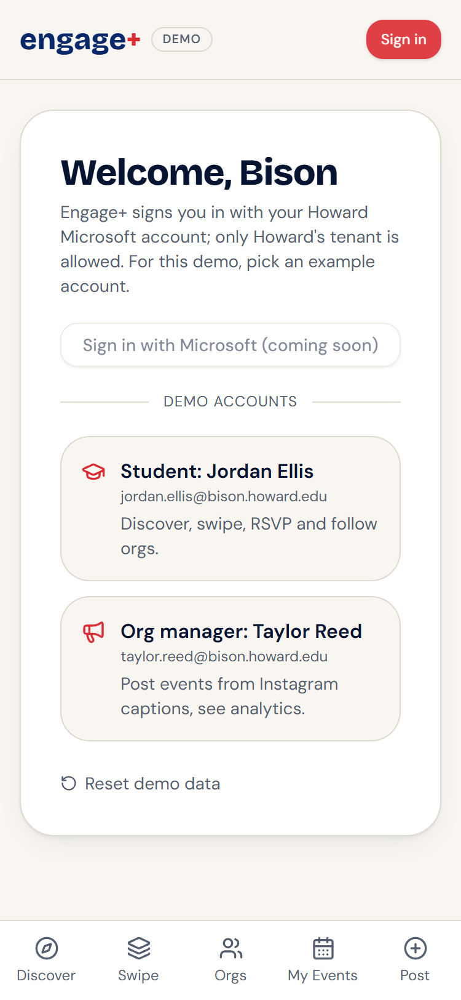

**Action:** Tap **Student: Jordan Ellis**. The **For you** swipe feed opens.

**Say:**
> "This is the heart of Engage+: a swipe feed picked just for you."

**You'll see:** **Caribbean Night Market**, with "Aaliyah, Simone going" and a counter reading **15 left**.

**Action:** Point at the **Why you're seeing this** box.

**Say:**
> "And it tells you why. Two of Jordan's friends are going to the Caribbean Night Market, and it's trending. Every card explains itself: orgs you follow, your interests, friends who are going."

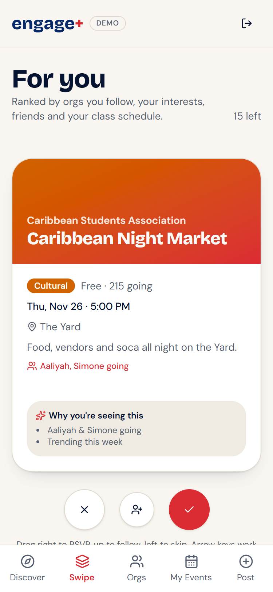

**Action:** Tap the red **✓** button.

**Say:**
> "Swipe right, or tap the check, to RSVP…"

**You'll see:** "RSVP'd: Caribbean Night Market" above the card. The next card appears, for example *Step Workshop for Beginners*.

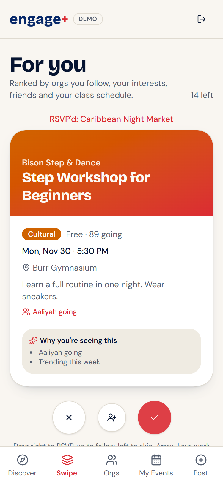

**Action:** Drag the card to the **left** with the mouse.

**Say:**
> "…swipe left to skip…"

**Tip:** Drag slowly at first so viewers see the **SKIP** label appear in the corner, then let go.

**Action:** Tap the **person +** button in the middle.

**Say:**
> "…or tap follow to keep up with the org without committing to the event."

**You'll see:** "Following [org name]", for example *Following Bison Coders*. The counter drops to **12 left**.

**Say:**
> "Each swipe is saved once per event. Swiping the same event twice never double-counts, and we have an automated test for exactly that."

---

## Segment 4 · Personalize — 2:45 to 3:50 · F1, F12, F18

**Action:** Tap **Discover** in the bottom bar. Tap the **New here? Take the 30-second quiz** banner.

**Say:**
> "A first-year doesn't follow anyone yet, so we start with a 30-second quiz."

**Action:** Answer **Build skills**, then **Hackathon with pizza**, then **STEM**.

**Say (while clicking):**
> "What do you want out of this semester, what's your ideal Friday night, what's your field…"

**You'll see:** **Your matches**: Bison Coders (86% match) and Pre-Med Society (73% match). Bison Coders already shows *Following* if you followed it during the swipe step.

**Say:**
> "…and it matches you with orgs. Those interests now feed into the ranking on your swipe feed."

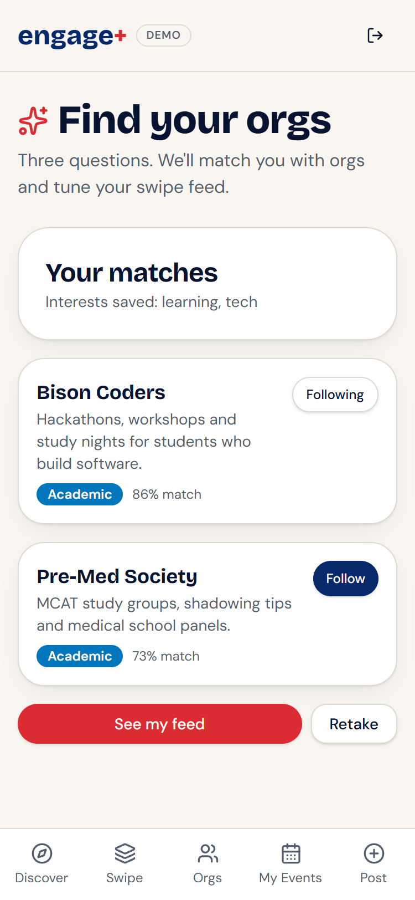

**Action:** Tap **My Events** in the bottom bar.

**Say:**
> "My Events has everything you've RSVP'd to: here, the Caribbean Night Market."

**Action:** Scroll down to **My class schedule**.

**Say:**
> "Here's a problem students told us about: you find a great event, and it's during your class. So you can add your schedule. Jordan has Data Structures, Calculus, and a writing seminar."

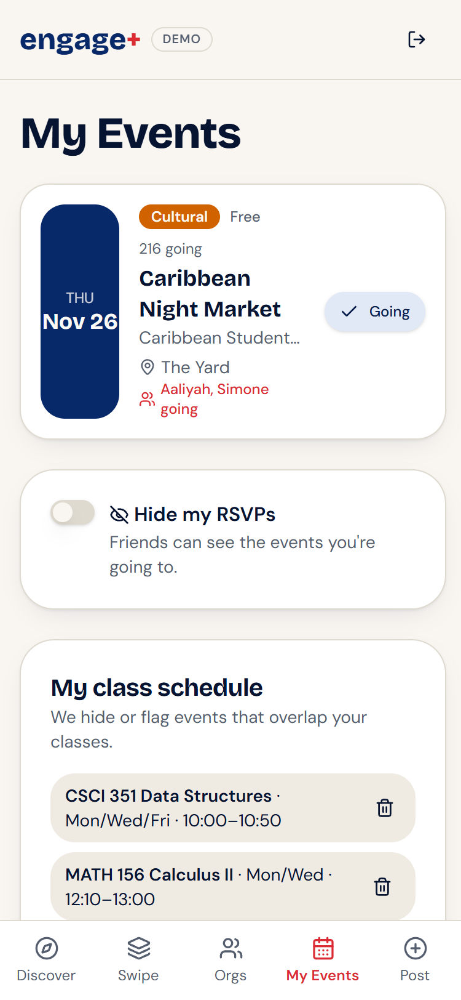

**Action:** Tap **Discover**. Scroll to the **Hide events during my classes** switch.

**Say:**
> "Back on Discover, Engage+ quietly hides anything that overlaps a class. Three events are hidden right now."

**Action:** Turn the switch **off**. Scroll to a card with the red warning.

**Say:**
> "Turn the filter off and they come back, flagged. This resume review overlaps Jordan's writing seminar."

**You'll see:** **Resume Review Drop-in** with "⚠ Overlaps ENGL 205 Writing Seminar".

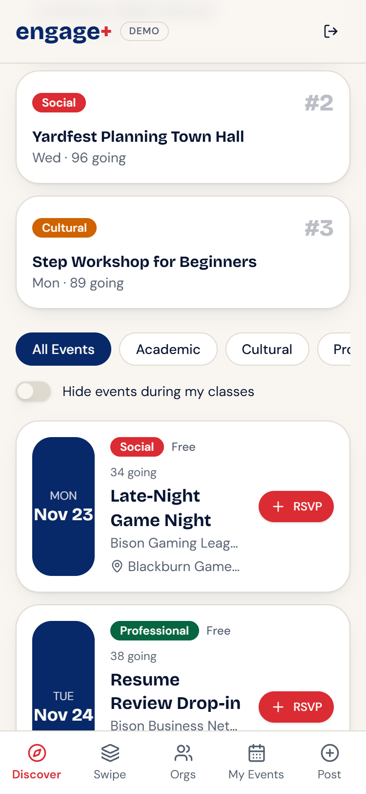

**Action:** Turn the switch back **on**. Tap **My Events** and flip **Hide my RSVPs** on, then off.

**Say:**
> "And privacy is built in. One switch hides your RSVPs, so friends can't see where you're going."

---

## Segment 5 · Event page — 3:50 to 4:15 · F20

**Action:** Tap **Discover**, then tap the **Caribbean Night Market** card title.

**Say:**
> "Each event page has the full details: when, where, how many are going, and which friends are going. If it clashes with a class, it says so here too."

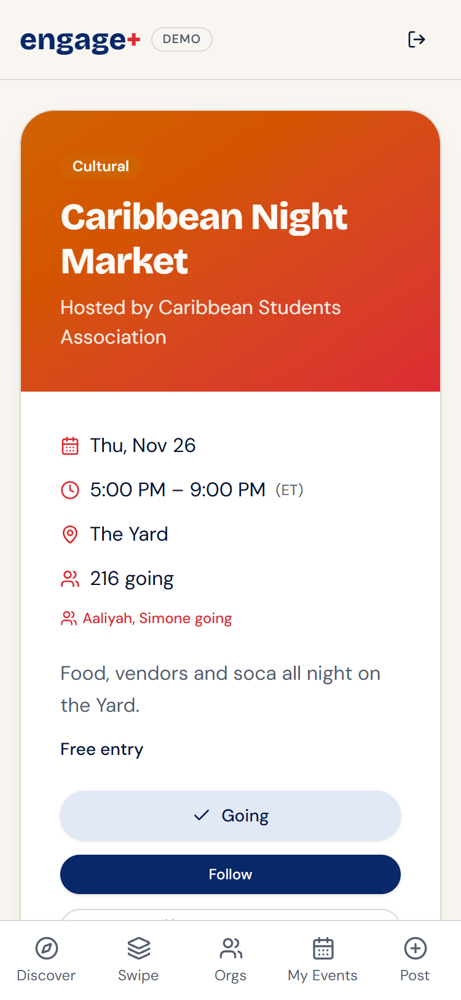

**Action:** Tap **Add to calendar**.

**Say:**
> "One tap adds it to Google, Apple or Outlook calendar."

**You'll see:** a file called `caribbean-night-market.ics` downloads.

**Tip:** If Chrome's download bubble covers the page, wait one second for it to fade before moving on.

---

## Segment 6 · The org side — 4:15 to 5:30 · F8, F10, F14

**Action:** Turn off the device toolbar (Ctrl+Shift+M) for desktop view. Zoom to 110–125% if it's hard to read. Tap the **sign-out arrow** (top right), then tap **Org manager: Taylor Reed**.

**Say:**
> "Now the other side. Taylor runs Bison Coders, and lands on the org dashboard."

**You'll see:** four tiles, roughly **641 followers · 611 event views · 175 swipe rights · 137 RSVPs**, then the **Event funnel**.

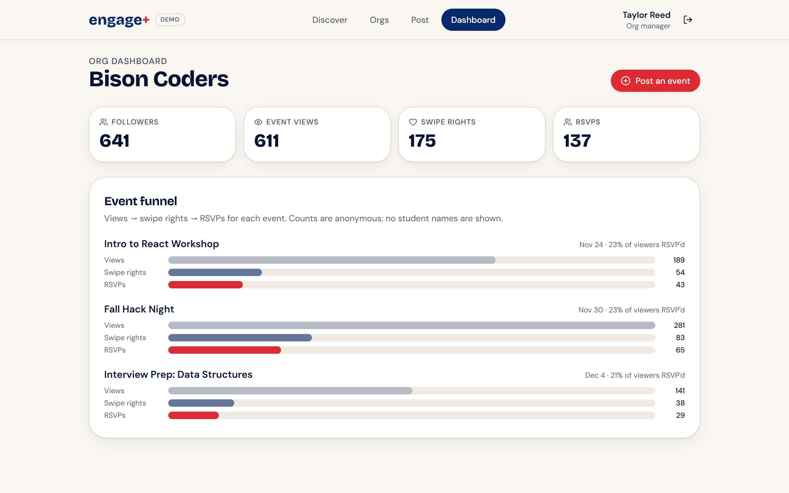

**Say:**
> "For each event, Taylor sees the funnel: how many students viewed it, swiped right, and actually RSVP'd. That shows which events land. Only the org's managers can see this page, and it's all anonymous counts. No student names."

**Action:** Tap **Post an event**.

**Say:**
> "Here's the part orgs care about most. They already write an Instagram caption for every event, and they shouldn't have to type it all again."

**Action:** Tap **Example 1**, then point at the caption in the box.

**Say:**
> "So they paste the caption, emojis, hashtags and all…"

**Action:** Tap **Fill the form**.

**Say:**
> "…and Engage+ fills in the event for them."

**You'll see:** the green line "Found title, date, time and location." The form now reads **Winter Code Jam · Academic · iLab, Founders Library · this Friday, 6:00 PM to 9:00 PM · Free**.

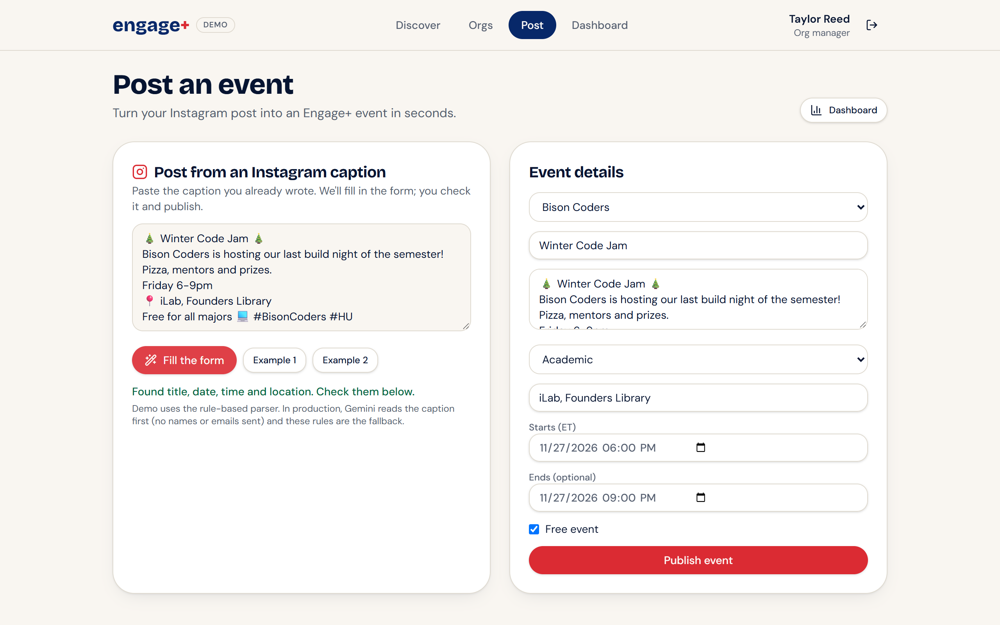

**Action:** Point at each filled field as you say it.

**Say:**
> "Title, category, location, Friday six to nine, free. In production, Google's Gemini reads the caption, and we never send it names or emails. If the AI is down, these same rules take over, so posting never breaks."

**Action:** Tap **Publish event**.

**Say:**
> "Taylor checks it, publishes, and it's live."

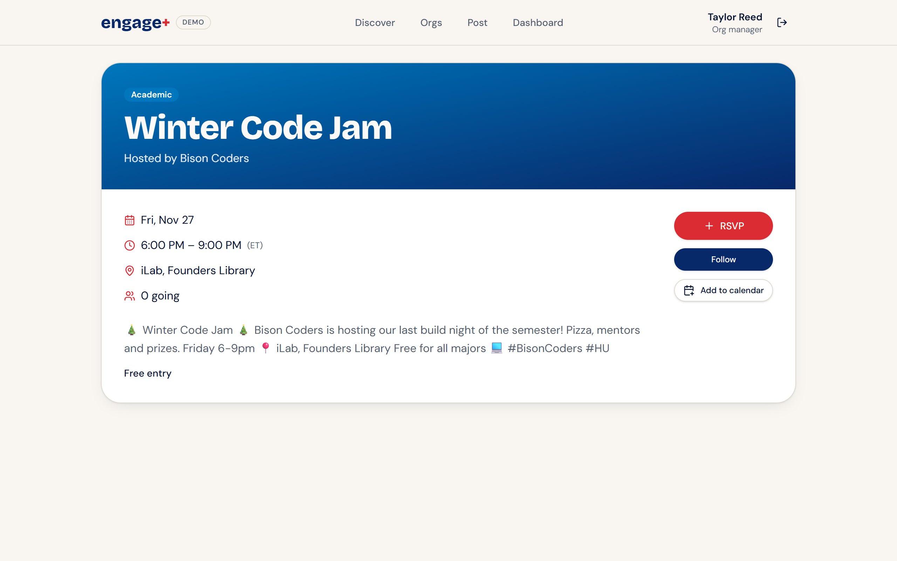

**Action:** Tap **Discover** in the top nav and scroll to **Winter Code Jam** (it sorts by date).

**Say:**
> "And it's in the student feed right away, ready for RSVPs."

---

## Segment 7 · Close — 5:30 to 6:10

**Action:** Show the "Under the hood" slide (React + TypeScript · GitHub Actions → GitHub Pages · 22 automated tests named by requirement).

**Say:**
> "Under the hood, this prototype is React and TypeScript, deployed automatically by GitHub Actions. Every feature you just saw ships with an acceptance test named after its requirement. Twenty-two run on every change."

**Action:** Show the roadmap slide.

**Say:**
> "Next, we're connecting it to our production API and database, turning on live Howard sign-in, moving the Gemini parser to the server, and adding notifications and a browser extension that posts to Engage+ straight from Instagram."

**Action:** Show the team slide.

**Say:**
> "We're Engage+. Find your people, and show up. Thank you."

---

## If something goes wrong mid-take

| What happened | Do this |
|---|---|
| Swipe feed shows "You're all caught up" | Tap **Start over**, or Reset demo data and re-record the segment |
| Quiz banner doesn't appear on Discover | The quiz was already taken. Reset demo data, or open `/quiz` from **Orgs → Match me with orgs** |
| Old RSVPs or a "Winter Code Jam" from a previous take show up | Sign in page → **Reset demo data** |
| A drag doesn't register | Use the buttons; they do the same thing |
| Caption missed a field | Use **Example 1**, which always finds all four. Any field can be typed in by hand. |
| Live site is down | Run locally: `cd apps/demo && npm ci && npm run dev` |

## If someone asks "Is this real?"

Answer honestly. Here's what the demo does and what production will do:

| | In this demo | In production |
|---|---|---|
| Data | Example data in the browser, reseeded daily | Postgres (Supabase) through our Express API |
| Sign-in | One-click example accounts | Microsoft sign-in, Howard tenant only (F21) |
| Caption parser | Rule-based, in the browser | Gemini returns JSON on the server; these rules are the fallback (F14) |
| "For you" ranking | Deterministic score with reasons | Same score, plus a Gemini re-rank (F3) |
| Class schedule | Typed in | Uploaded (F12) |
| Not shown yet | Notifications, extension, co-hosted events | F7, F15, F19 |

## Requirement map

F1 quiz · F2 swipe · F3 ranking · F4 trending · F8 dashboard · F10 posting · F12 class conflicts · F13 filters · F14 caption parser · F17 friends going · F18 hide RSVPs · F20 calendar export · F21 sign-in (stand-in)

---

## Teleprompter version (narration only)

Read this straight through while someone else drives, or record the voice-over separately and lay it over the screen recording.

> **[1]** At Howard, there are dozens of events every week: workshops, cultural nights, recruiter mixers, open mics. But most students never hear about them, or they find out the day after on someone's Instagram story. Anthology Engage is the official record of every org and event, but it's a directory. It isn't built for discovery. So we built Engage+. It sits on top of Engage as a mobile-first website that helps you find events, and helps orgs fill them.
>
> **[2]** The home page opens with what's trending: the events with the most RSVPs this week. You can filter by category. Here's everything professional: resume reviews, attorney panels, a recruiter mixer… or just search. Every card shows the date, the host, the location, and how many people are going.
>
> **[3]** In the real product, you sign in with your Howard Microsoft account, and our server only lets in accounts from Howard's tenant. That's in testing, so for this demo we'll use two example accounts. This is the heart of Engage+: a swipe feed picked just for you. And it tells you why. Two of Jordan's friends are going to the Caribbean Night Market, and it's trending. Every card explains itself: orgs you follow, your interests, friends who are going. Swipe right, or tap the check, to RSVP… swipe left to skip… or tap follow to keep up with the org without committing to the event. Each swipe is saved once per event. Swiping the same event twice never double-counts, and we have an automated test for exactly that.
>
> **[4]** A first-year doesn't follow anyone yet, so we start with a 30-second quiz. What do you want out of this semester, what's your ideal Friday night, what's your field… and it matches you with orgs. Those interests now feed into the ranking on your swipe feed. My Events has everything you've RSVP'd to. Here's a problem students told us about: you find a great event, and it's during your class. So you can add your schedule. Back on Discover, Engage+ quietly hides anything that overlaps a class. Turn the filter off and they come back, flagged. This resume review overlaps Jordan's writing seminar. And privacy is built in. One switch hides your RSVPs, so friends can't see where you're going.
>
> **[5]** Each event page has the full details: when, where, how many are going, and which friends are going. If it clashes with a class, it says so here too. One tap adds it to Google, Apple or Outlook calendar.
>
> **[6]** Now the other side. Taylor runs Bison Coders, and lands on the org dashboard. For each event, Taylor sees the funnel: how many students viewed it, swiped right, and actually RSVP'd. That shows which events land. Only the org's managers can see this page, and it's all anonymous counts. No student names. Here's the part orgs care about most. They already write an Instagram caption for every event, and they shouldn't have to type it all again. So they paste the caption, emojis, hashtags and all… and Engage+ fills in the event for them. Title, category, location, Friday six to nine, free. In production, Google's Gemini reads the caption, and we never send it names or emails. If the AI is down, these same rules take over, so posting never breaks. Taylor checks it, publishes, and it's live. And it's in the student feed right away, ready for RSVPs.
>
> **[7]** Under the hood, this prototype is React and TypeScript, deployed automatically by GitHub Actions. Every feature you just saw ships with an acceptance test named after its requirement. Twenty-two run on every change. Next, we're connecting it to our production API and database, turning on live Howard sign-in, moving the Gemini parser to the server, and adding notifications and a browser extension that posts to Engage+ straight from Instagram. We're Engage+. Find your people, and show up. Thank you.
